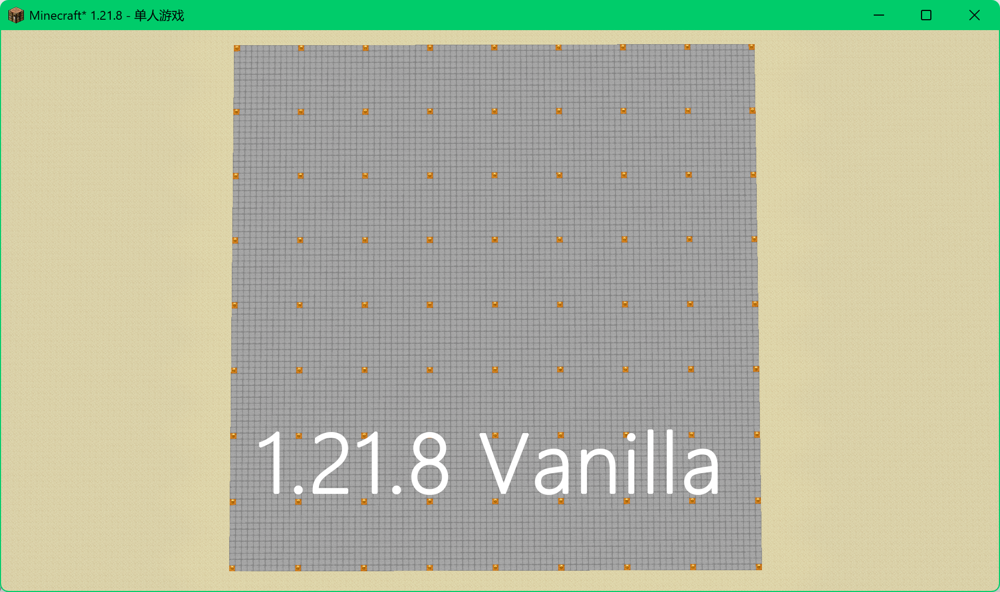
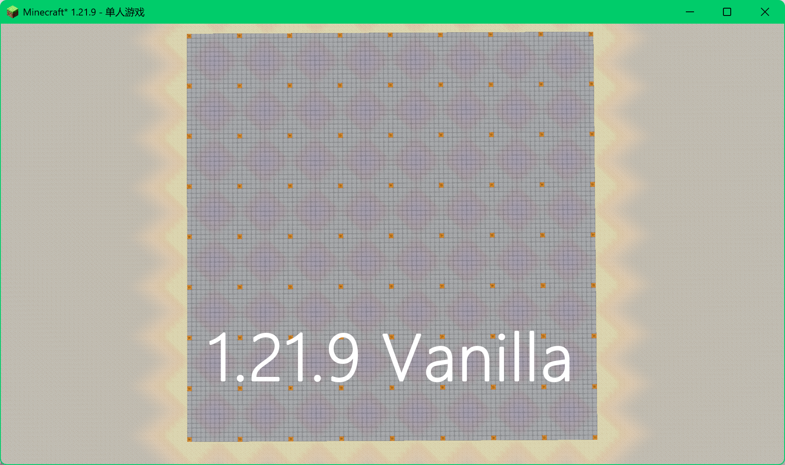
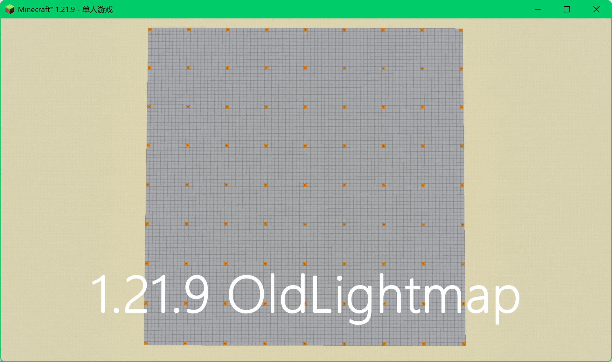

# Old Lightmap

<p align="center">
  <b>English</b> ·
  <a href="README.zh-CN.md">简体中文</a>
</p>

Old Lightmap is a client-side Fabric mod that restores the Minecraft 1.21.8 lightmap algorithm on Minecraft 1.21.9 and newer versions.

## Lighting comparison

The following screenshots compare the original lighting in Minecraft 1.21.8, the changed lighting in Minecraft 1.21.9, and the restored result with Old Lightmap, all at `time set 11800`.

<p align="center">
  
  
  
</p>

<p align="center">
  <sub>Minecraft 1.21.8 Vanilla</sub> &nbsp;&nbsp;&nbsp;
  <sub>Minecraft 1.21.9 Vanilla</sub> &nbsp;&nbsp;&nbsp;
  <sub>Minecraft 1.21.9 + Old Lightmap</sub>
</p>

## Installation

1. Install the matching version of [Fabric Loader](https://fabricmc.net/).
2. Download the JAR for your Minecraft version.
3. Put the JAR into the `.minecraft/mods` directory.
4. Start Minecraft.

Sodium is optional. If Sodium is installed, the mod adds a configuration tab to Sodium's settings screen. If Sodium is not installed, the mod cannot be configured.

## Build from source

Requirements:

- Minecraft 1.21.9–1.21.11 requires Java 21.
- Minecraft 26.1.x, 26.2 and 26.3 require Java 25.

Build all distributions:

```bash
./gradlew clean build
```

Build an individual distribution:

```bash
./gradlew :mc1_21:build
./gradlew :mc26_1:build
./gradlew :mc26_2:build
./gradlew :mc26_3:build
```

The generated JAR files are written to the corresponding `versions/*/build/libs/` directory.

## License

Old Lightmap is licensed under the [GNU Lesser General Public License v3.0 (LGPLv3)](LICENSE).
